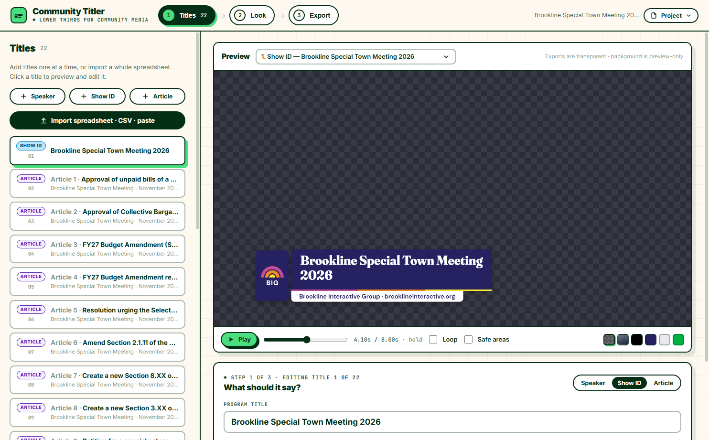
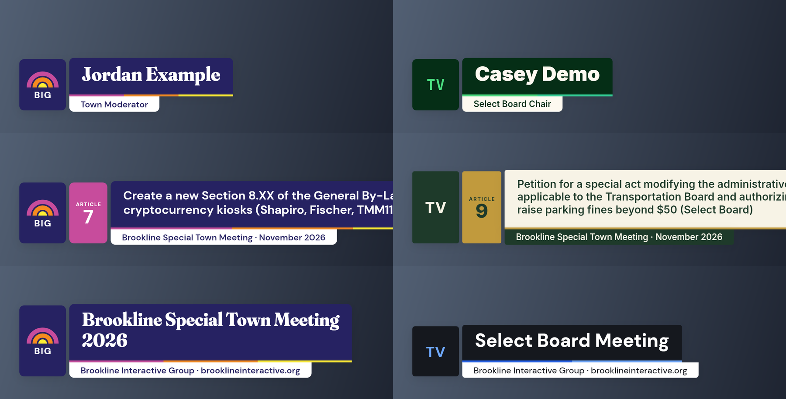

# Community Titler

**Beautiful, animated lower-third titles with transparent alpha backgrounds — built for community media stations.**

Type your titles in (or import a whole spreadsheet), pick a style, and export broadcast-ready graphics with real alpha channels for OBS, vMix, CasparCG, NLEs, or a key/fill DeckLink output into your video switcher.

Made by [Brookline Interactive Group](https://brooklineinteractive.org) for every community access station. Free, open source (MIT), and it runs entirely in your browser — nothing is uploaded anywhere.



## What it makes

Three kinds of lower thirds, each with an animate-in / hold / animate-out timeline:

| Type | For | Example |
|---|---|---|
| **Show identifier** | Opening a program — event title plus your station name and URL | *Brookline Special Town Meeting 2026 · Brookline Interactive Group · brooklineinteractive.org* |
| **Speaker ID** | Identifying who's talking — name + role | *Jordan Example · Town Moderator* |
| **Warrant article** | Dense info cards — numbered badge + full article title + meeting tag | *ARTICLE 7 · Create a new Section 8.XX of the General By-Laws banning cryptocurrency kiosks…* |



## Quick start

**Use it in your browser (no install):** open the hosted app → **https://amateurmenace.github.io/community-titler/**

**Or run it locally:**

```bash
git clone https://github.com/amateurmenace/community-titler.git
cd community-titler
npm install
npm run dev
```

The app opens with a loaded sample project: the full warrant for the Brookline Special Town Meeting (November 2026) — 21 articles plus the show identifier — so you can hit **Export all** and see the whole pipeline work.

## Bulk titles from a spreadsheet

This is the headline feature: make *many* titles at once.

1. Put your titles in Google Sheets, Excel, or any CSV with columns:

   | type | badge | primary | secondary |
   |---|---|---|---|
   | `show` | | Brookline Special Town Meeting 2026 | *(blank = station name + URL)* |
   | `speaker` | | Jordan Example | Town Moderator |
   | `article` | Article 5 | Resolution urging the Select Board… | Special Town Meeting · November 2026 |

2. In the app: **Import spreadsheet** → drop the `.csv`/`.xlsx`, or just **copy-paste the cells straight from Google Sheets**.
3. **Export all.**

Friendly details: header names are flexible (`name`, `title`, `number`, `role`… all recognized), plain numbers become “Article N”, and rows like `5. Resolution regarding…` are split into badge + title automatically. Sample files live in [`public/samples/`](public/samples/).

## Exporting alpha for OBS and key/fill

Pick a format in the export bar — every one carries a real alpha channel:

- **ProRes 4444 (.mov)** — the broadcast workhorse. Biggest files, flawless alpha, decodes effortlessly in OBS, and encodes fast even in the browser (~30 s per title). **Recommended for key/fill playout.**
- **WebM (.webm)** — small files, great for OBS overlay scenes. In-browser encoding is slow (VP8, ~2 s per frame); the CLI below renders WebM (VP9) far faster.
- **PNG still (.png)** — one transparent frame per title, instantly.
- **PNG sequence (.zip)** — every frame as numbered PNGs for NLEs / CasparCG.

In Chrome or Edge you'll be asked for an output folder and files are written straight into it; other browsers fall back to one download per file.

### OBS setup

1. **Sources → + → Media Source** → pick your `.mov` or `.webm` → check **“Show nothing when playback ends”**. The transparency just works — put it over your program scene.
2. Restart the clip to take it on air: select the source and **Restart** (or hotkey it: Settings → Hotkeys → *Restart media*).

### Key/fill out a DeckLink to your switcher

1. **Tools → Decklink Output** in OBS.
2. Pick your DeckLink device and format, and set **Keyer: External** (needs a keyer-capable card: Duo 2, Quad 2, 4K Extreme, 8K Pro…).
3. The card now sends **fill** on one SDI and **key** on the other — take them into your switcher (e.g. an ATEM aux/keyer pair as a luma/linear key) and cut graphics like a TV truck.

Tip: for key/fill, build an OBS scene containing *only* the title graphics (transparent everywhere else) and route that scene's Decklink output.

## Styles & making it yours

Four built-in styles ship today, including **BIG — Brookline Interactive** (navy, rainbow arches, stripes, Gotham-style Montserrat type), plus neutral **Broadcast Slate**, civic **Town Hall**, and **Minimal Light**.

To rebrand for your station: **Duplicate & customize** in the Style panel → set your station name, short mark, URL, colors, corner radius, animation (slide / rise / wipe / fade), upload your **logo PNG**, even add your own **font file**. Then **Export** the style as a `.theme.json` to share with your team — or open a PR to add your station's theme as a built-in!

Projects auto-save in your browser; **Save project file** writes a portable `.json` you can archive or move between machines.

## CLI batch rendering (fast, optional)

If you have [ffmpeg](https://ffmpeg.org) installed, the CLI renders the same pixels much faster than the in-browser encoder:

```bash
npm run render -- --csv mytitles.csv --format prores --out exports/tonight
```

```bash
npm run render -- --sample --format webm --theme big --hold 8
```

Formats: `prores`, `webm`, `png`, `pngseq`. Run `npm run render -- --help` for every flag (`--theme your-station.theme.json`, `--size 1280x720`, `--fps 59.94`, `--only 3,5`, …).

## For developers

- Vite + React + TypeScript. The actual drawing lives in [`src/renderer/core.js`](src/renderer/core.js) — a pure, dependency-free canvas renderer used identically by the browser preview, the in-browser ffmpeg.wasm encoder, and the Node CLI, so what you preview is exactly what exports.
- In-browser video encoding is ffmpeg.wasm (single-threaded core, served same-origin — works offline and on GitHub Pages).
- `npm run build` produces a fully static `dist/` you can host anywhere; pushes to `main` auto-deploy to GitHub Pages via [`.github/workflows/deploy.yml`](.github/workflows/deploy.yml).

PRs welcome — new themes, new title layouts, translations, CasparCG/HTML output, whatever your station needs.

## License

MIT. Bundled [Montserrat](https://github.com/JulietaUla/Montserrat) fonts are SIL OFL 1.1. The BIG style is included with Brookline Interactive Group's blessing; your station's logo and branding remain, of course, your own.
